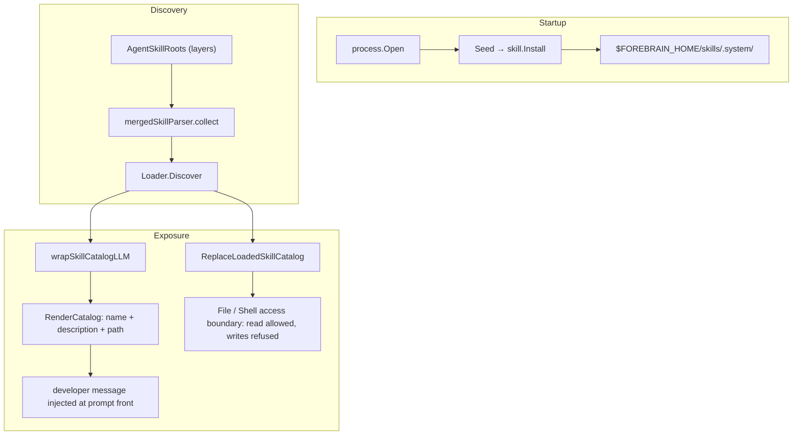

# Skills Internals

This page is based on the Forebrain Harness source and explains how skill
loading actually works: the `SKILL.md` file contract, which paths skills load
from and in what order, the discovery and parsing rules, how skills are
exposed to the LLM, and how their resources are guarded. It is written for
developers and contributors who need to understand skill internals.

## Core Conclusion

Skill loading in Forebrain Harness is "root-set resolution plus per-session
directory injection":

1. Scan a fixed priority-ordered set of skill roots for subdirectories that
   contain a `SKILL.md`;
2. Render every enabled skill into a catalog of name, description, and path;
3. Inject that catalog as a developer instruction at the front of the prompt
   through an LLM wrapper, **rendered and frozen exactly once per session**;
4. Skill bodies never enter the prompt — the model reads `SKILL.md` on demand
   with its file tools. Only an explicit slash-command activation inlines the
   body.



## The SKILL.md Contract

The minimum a skill needs in Forebrain Harness is a subdirectory under one of
the skill roots containing a `SKILL.md`:

```text
<skill-root>/<skill-name>/SKILL.md
```

A `SKILL.md` has two parts (`pkg/skill/skill.go`): it **must start with a
YAML frontmatter block delimited by `---`**, followed by the Markdown body.
The parser splits with `strings.SplitN(content, "---", 3)` — everything after
the first segment is YAML, the rest is the body.

Frontmatter fields (`pkg/skill/skill.go:45-61`):

| Field | Meaning |
|------|------|
| `name` | Skill name; the directory name is used when omitted. |
| `description` | The description shown to the model in the catalog (required — without it the skill is not listed anywhere). |
| `license` | License. |
| `compatibility` | Compatibility notes. |
| `metadata` | Arbitrary additional metadata. |
| `allowed-tools` | Allowed-tools note; both spellings are decoded through a dedicated struct and folded by `normalizeAllowedTools`. |
| `slash-command` | `*bool`, default `true` — auto-derives a slash command of the same name; `false` skips the derivation. |

## Load Paths And Priority

The single entry point for root resolution is the layer table
`skillLayers(home, workspaceRoot, projectRoots)` (`pkg/skill/origin.go:77-97`),
consumed by `skill.AgentSkillRoots` at `pkg/run/runner.go:966`. It returns the
following layers, highest priority first:

| Priority | Path | Notes |
|--------|------|------|
| 1 | `<project root>/.forebrain/skills`, `.agents/skills`, `.claude/skills`, `.codex/skills` | Trusted project skill directories, behind the trust gate |
| 2 | `<workspaceRoot>/skills` | Current agent workspace skills |
| 3 | `$FOREBRAIN_HOME/skills` | User / globally installed skills |
| 4 | `~/.agents/skills`, `~/.claude/skills`, `~/.codex/skills` | Cross-tool user-level directories |
| 5 | `$FOREBRAIN_HOME/skills/.system` | Embedded system skills, lowest priority |

In practice: project skills are shared with everyone working on the checkout,
home and user-level skills are personal across projects, and a user-installed
skill always outranks a same-name built-in because `.system` is reached as its
own root below the shared root, never through it.

### The Project Skill Trust Gate

The highest-priority project directories are not loaded unconditionally
(`pkg/skill/roots.go:46-60`). To reach the model prompt, two things must hold:

1. **The launch trust prompt answered for the directory.** The trust prompt is
   the whole gate, and it runs for every directory — version controlled or
   not — so a trusted plain directory gets the same project skills a trusted
   checkout gets (`pkg/skill/roots.go:46-51`).
2. **A persisted trust decision exists.** `safety.IsTrusted` reads the exact
   persisted decision for the canonical project root; missing state is
   untrusted and malformed state returns an error, so callers fail closed
   (`pkg/safety/engine.go:993-996`, `pkg/skill/roots.go:103-106`).

This is defensive design: skills that arrive with a checkout are instructions,
often with scripts. Only after the user has explicitly trusted the project are
they described to the model.

### Same-Name Shadowing

A same-name skill in a higher-priority root shadows the lower-priority copy:
the scan is first-come-first-served, and a directory key or skill name already
claimed is never recorded twice (see Discovery And Parsing below).

> The management view (`Hub` in `pkg/skill/hub.go`) uses the same layer order
> but project directories pass through `ProjectSkillRootsForDir` **without the
> trust gate** (`pkg/skill/hub.go:31-36`). That view is for humans listing,
> inspecting, and toggling; whether a skill reaches the model prompt is still
> decided by `TrustedProjectSkillRoots`.

## Discovery And Parsing

`skill.Loader{Roots, StateRoot}.Discover()` walks the roots through
`mergedSkillParser.collect()` (`pkg/skill/skillrt.go:91-134`) on top of the
shared scanner `scanSkillRoots` (`pkg/skill/discover.go:51-61`):

1. Only directories count, and **dot-directories are never descended into**;
   the built-in skills live under `.system`, which is a root of its own at
   priority 5, not a scan exception. A directory without a parseable
   `SKILL.md` is a bundle and is descended into **exactly one level**
   (`maxSkillNestingDepth = 1`, `pkg/skill/discover.go:63-89`).
2. A `SKILL.md` that is unreadable, empty, or fails to parse → skipped.
3. An empty `description` → skipped entirely: the description is the whole of
   how a skill reaches the model, so a skill without one could never be chosen
   (`pkg/skill/discover.go:96-98`).
4. Disabled skills are filtered by canonical path against the toggle store at
   `<workspaceRoot>/state/skills/disabled.json`
   (`pkg/skill/skillrt.go:97-104`, `pkg/skill/state.go:45`).
5. Deduplication: `seenDirs` (by lowercased relative path) and `seenNames`
   (by lowercased skill name) guarantee the first-scanned root wins — a
   higher-priority root shadows a lower one
   (`pkg/skill/skillrt.go:105-120`).
6. Ordering: by lowercased name, then a stable path tie-break in
   `CatalogEntries`, so the same skill set renders byte-identically every time
   (`pkg/skill/skillrt.go:130-132`, `pkg/skill/catalog.go:139-145`).

## How Skills Reach The LLM

### Main Mechanism: Session-Prefix Injection And Progressive Disclosure

At `pkg/run/runner.go:966-970`, the LLM client is wrapped:

```go
skillRoots := skill.AgentSkillRoots(r.Home, r.workspaceRoot(), r.LaunchProject)
...
llmClient = wrapSkillCatalogLLM(llmClient, skillRoots, r.workspaceRoot(),
    r.SessionStore, r.skillOfferGuidance)
```

`skillCatalogLLM` (`pkg/run/skills.go:97-120`) runs before every `Execute`:

- It renders the catalog once per session via `catalogForSession` and then
  reuses that exact string for the session's lifetime.
- The rendered result is injected through
  `memory.InjectDeveloperInstruction` as a `role=developer`, `IsMeta=true`
  message — after the system message when one exists, otherwise at the very
  front (`pkg/memory/instruction.go:351-357`).

The catalog is produced by `RenderCatalog` (`pkg/skill/catalog.go:56-83`) and
is structured as:

- `## Skills` plus a short introduction;
- `### How to use skills` — the progressive-disclosure protocol: decide from
  the description whether a skill applies, then **read the full `SKILL.md`
  with the file tools**, resolving relative paths against the skill's own
  directory, reading `scripts/`, `assets/`, and `references/` as needed; a
  skill does not carry across turns;
- `### Available skills` — one line per skill, `- name: description (path)`,
  where `path` points at that skill's `SKILL.md`. Every field is flattened to
  a single line first (`catalogField`), so a newline planted in frontmatter or
  a directory name cannot forge a second catalog entry
  (`pkg/skill/catalog.go:85-102`).

The key property: **the catalog carries only name, description, and path — the
skill body never enters the prompt.** The model reads from disk on demand,
which keeps the tool array stable for the session's whole life.

### Why Frozen Per Session

The catalog sits ahead of the entire conversation. A provider only hits its
prefix cache when those bytes are byte-for-byte unchanged; re-reading the
skill directories every turn would make any mid-session install, rename, or
toggle invalidate the system prompt, the tool definitions, and every cached
turn before it. Skill-set changes therefore take effect in the **next
session** (`pkg/skill/catalog.go:41-53`, `pkg/run/skills.go:50`).

### Explicit Slash-Command Activation

Unless a `SKILL.md` declares `slash-command: false`, every skill is derived
into a slash command (`pkg/turn/skills.go`). An explicit call goes through
`skill.LoadActivation`, which renders the full `<skill>` block — name, path,
and body — with a `<context>` element carrying the resource inventory (the
raw document; the same shape Codex uses,
`pkg/skill/activation.go:108-113`), and injects it inline as an ephemeral
user-meta message via `WithExplicitSkillActivation`
(`pkg/run/skills.go:287-292,441-457`). The model then does not need to read
`SKILL.md` itself.

### The Loaded-Skill Resource Boundary

The same discovery result also feeds the runtime tool state
(`pkg/run/runner.go:1212-1230`):

```go
discoveredSkills, skillErr := (skill.Loader{
    Roots:     skillRoots,
    StateRoot: r.workspaceRoot(),
}).Discover()
...
r.tools.ReplaceLoadedSkillCatalog(loadedSkills)
```

The loaded-skill catalog in `pkg/tool/loaded_skills.go` is the single source
of truth for skill resource access:

- File and shell tools may **read** through loaded-skill roots even when they
  are outside the ordinary allowed roots — the catalog told the model to read
  those files.
- **Writes addressing a loaded skill are refused**, including through a
  shortened catalog path: the write is repaired to the real skill location and
  reported, so a "change this skill" write cannot become a stray directory
  beside it (`LoadedSkillWriteTarget`,
  `pkg/tool/loaded_skills.go:319-341`).
- A shell command that addresses a loaded skill and is **not provably
  read-only** is held for the user's explicit approval, with a reason naming
  the skill; provably read-only commands keep the normal shell policy
  (`LoadedSkillShellAccessReason`, `pkg/tool/loaded_skills.go:343-354`).

### Seeding The System Skills

`process.Open` → `Seed` → `skill.Install`
(`pkg/process/seed.go:12-13`) unpacks the embedded system skills from
`//go:embed system_assets/*` (`pkg/skill/system.go:14`) into
`$FOREBRAIN_HOME/skills/.system/`. Idempotence rides on the
`.forebrain-system-skills.marker` file: its content is a 16-char hex SHA-256
fingerprint over all embedded asset paths and contents, and the destination is
only erased and rewritten when the fingerprint changes
(`pkg/skill/system.go:29,51-60`). This is where the bundled skills — docx,
pdf, xlsx, pptx, frontend-design, image-edit, plan, the caveman family,
skill-workshop, context-save, context-restore — come from.

## When Changes Take Effect

Skill management operations (create / update / install / toggle, see
`pkg/skill/service.go`) only write to disk and refresh the process-level
metadata and slash-command tables. Because the catalog is frozen into the
session prefix, the changes enter the model-visible catalog when the **next**
session's `Runner.Load` rescans the roots. The loaded-skill catalog is
replaced atomically on every load, so reloads and primary-agent switches
cannot retain roots from a previous runtime snapshot
(`pkg/run/runner.go:1227-1230`).

## Source Location Index

| Topic | File(s) |
|------|----------|
| Skill data model and `SKILL.md` parsing | `pkg/skill/skill.go` |
| Layer table, root resolution, project trust gate | `pkg/skill/roots.go`, `pkg/skill/origin.go` |
| Shared scan rules (bundles, dot-dirs, nesting) | `pkg/skill/discover.go` |
| Discovery / walk / dedup / filtering | `pkg/skill/skillrt.go` |
| Catalog rendering | `pkg/skill/catalog.go` |
| Disabled-skill store | `pkg/skill/state.go` |
| Explicit activation rendering | `pkg/skill/activation.go` |
| System skill seeding | `pkg/skill/system.go`, `pkg/process/seed.go` |
| LLM injection wrapper | `pkg/run/skills.go`, `pkg/run/runner.go` |
| Instruction injection channel | `pkg/memory/instruction.go` |
| Skill resource access boundary | `pkg/tool/loaded_skills.go` |
| Slash-command derivation | `pkg/turn/skills.go` |
