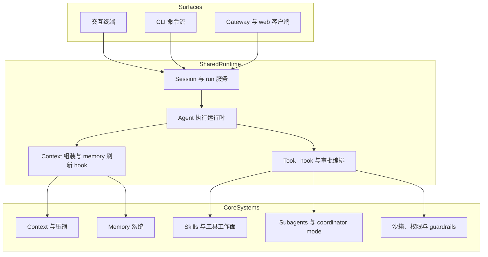
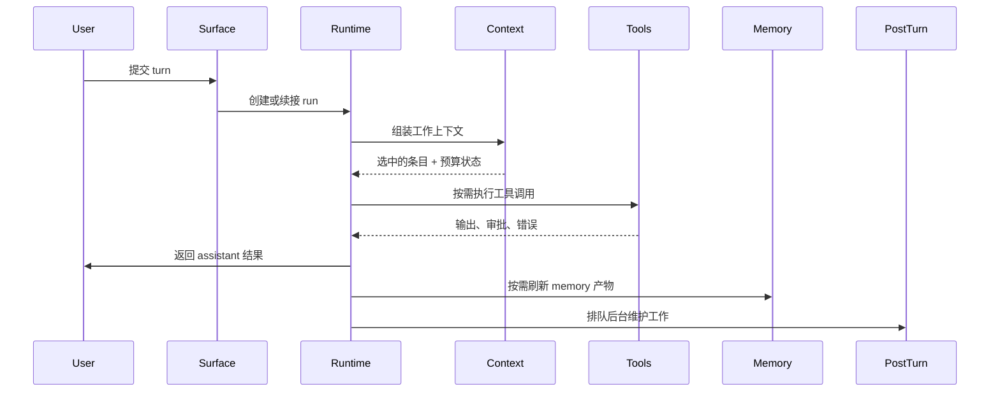

# 架构

Forebrain Harness 不是包着一次模型调用的单一界面。它是一个多工作面 agent
运行时，为持续的技术工作而建。

本页在产品层面解释系统架构：

- Forebrain Harness 暴露哪些工作面
- 这些工作面依赖哪些共享运行时层
- memory、tools、subagents、safety 等核心系统如何拼在一起

## 架构目标

Forebrain Harness 为比普通聊天更长、更有状态、对运维更敏感的工作流而
设计。

这带来与普通助手不同的架构要求：

- 系统必须保持会话连续性
- 它必须安全地执行工具
- 它必须协调长时间运行的工作
- 它必须同时支持交互式和有服务支撑的工作面
- 它必须让 memory、context 和审批系统在这些工作面之间保持一致

## 三大主层

在最高层面，可以把 Forebrain Harness 理解为三个协作的层。

## 工作面层

Forebrain Harness 暴露多个面向用户的工作面，因为不同的运维上下文需要不同
的交互风格。

### 交互终端

终端工作面为日常本地工作优化。

用户在这里最直接地体验到：

- 实时 turn
- 斜杠命令
- 审批
- 工具输出
- 会话恢复行为
- 本地 shell 与 workspace 交互

终端工作面刻意贴近工作本身。它是把 Forebrain Harness 当作编码 agent、
而不是远程服务来用的最直接方式。

### CLI 命令流

Forebrain Harness 也暴露不以开放式交互会话组织的命令式流程。

这对以下场景要紧：

- 检视
- 诊断
- 运维控制
- setup 与校验工作流

### Gateway 与 web 客户端

Gateway 工作面把 Forebrain Harness 变成服务运行时。

这在以下情况要紧：

- 浏览器或 web 客户端需要与 Forebrain Harness 对话
- 远程或共享使用是要紧事
- 集成经 HTTP 回调或服务端点到达
- 会话状态必须投影到单个本地终端实例之外

## 共享运行时层

共享运行时是 Forebrain Harness 不至于裂成几个独立产品的关键。

无论你用哪个工作面，Forebrain Harness 都要对同样的问题给出共同答案：

- 这是哪个 session？
- 当前活跃的是哪个 run？
- 哪个 agent 负责？
- 应该注入什么 context？
- 哪些工具可用？
- 哪些审批是必需的？
- turn 之后应该刷新哪些 memory 产物？

### Session 与 Run 服务

Forebrain Harness 把工作表示为 sessions 和 runs，而不是孤立的
prompt/response 对。

这个区分要紧，因为：

- session 承载连续性
- run 承载一个 turn 或一个委派单元的执行状态
- 工具调用、审批、subagent 和 turn 后任务都可以挂在 run 上

这是让 Forebrain Harness 能展示以下内容的骨架：

- 活跃的工作
- 被中断的工作
- 子工作
- 审计线索
- 可恢复的状态

### Agent 执行运行时

执行运行时是把配置好的 agent 变成活的、在工作中的进程的那一层。

它的职责包括：

- 选定活跃的 agent 定义
- 解析 model-provider 链
- 构建 prompt
- 注册工具
- 运行 hook
- 应用审批与策略
- 处理委派的工作

Forebrain Harness 从这里开始不再是"一堆配置"，而开始表现得像一个运维
系统。

### Context 组装与 Turn 后工作

Forebrain Harness 不是简单地把"最近的消息"喂给模型。

每个 turn 之前，运行时从多个来源组装工作上下文。当模型活跃历史达到自动
压缩阈值时，它会在继续采样之前被同步替换成一个紧凑的 checkpoint。

这是与无状态聊天系统的重大架构差异。

## 核心系统层

核心系统层包含让 Forebrain Harness 能胜任严肃多步工作的机制。

### Context 与压缩

Forebrain Harness 把 context 当作受管理的预算来跟踪。它不把上下文溢出
当作意外的失败状态。

这意味着运行时可以：

- 按整个活跃上下文或 compact 前缀之后的增长来记账
- 把模型的完整上下文窗口当作硬上限执行
- 在 turn 之前或采样之间自动压缩
- 用持久的 provider 或本地 checkpoint 替换活跃历史

### Memory 系统

Forebrain Harness 的 memory 层刻意拆分，而不是塌缩成一个含糊的特性。

它包括：

- 面向检索的搜索 memory
- 持久的 per-project 与全局 memory
- transcript 连续性提炼
- 治理与合并路径

每一部分都存在，因为 agent 系统里的"memory"实际意味着几个不同的
问题。

### Skills 与工具工作面

Forebrain Harness 把两者分开：

- tools，执行动作
- skills，打包可复用的操作知识

这让运行时保持行动能力，又不把一切压平成一张扁平的命令清单。

### Subagents 与 Coordinator Mode

Forebrain Harness 支持多种形式的委派工作。

在高层看：

- 主代理可以留在主线程里
- coordinator mode 可以把工作拆成步骤
- subagent 可以承接有边界的子工作
- 子 run 可以被独立跟踪和恢复

这让 Forebrain Harness 能从单 turn 任务扩展到结构化的多步执行。

### 沙箱、权限与 Guardrails

Forebrain Harness 的安全是分层的，不是一整块。

架构让这些关注点彼此独立：

- 权限策略
- 审批记忆
- 沙箱执行
- 文件系统与网络限制
- guardrail 式的输入输出控制

正是这种分离让 Forebrain Harness 保持有用，又不必把每个动作压平成粗暴的
允许或阻断决定。

## 穿过系统的控制流

一个典型的 turn 是这样：

## 为什么这个架构要紧

架构价值不是为了抽象而抽象。它是实用的。

它让 Forebrain Harness 能够：

- 延续长会话而不塌缩成 transcript 蔓生
- 在终端与 gateway 工作面之间暴露相同的核心行为
- 协调委派工作而不丢失可追溯性
- 把安全决定挂到真实的执行流上
- 把运维状态保存到单个对话窗口之外

## 实用的阅读指引

如果你想理解 Forebrain Harness 的某个具体部分，继续读：

- [上下文与压缩](/zh/guide/context-and-compaction) — prompt 预算管理
- [跨会话记忆](/zh/guide/memory-systems) — 召回、transcript 连续性与合并
- [用 Skill 扩展](/zh/guide/skills-and-tools) — 能力工作面
- [委派给子代理](/zh/guide/subagents) — 委派与任务结构
- [保持掌控](/zh/guide/safety-model) — 审批、沙箱与 guardrails
